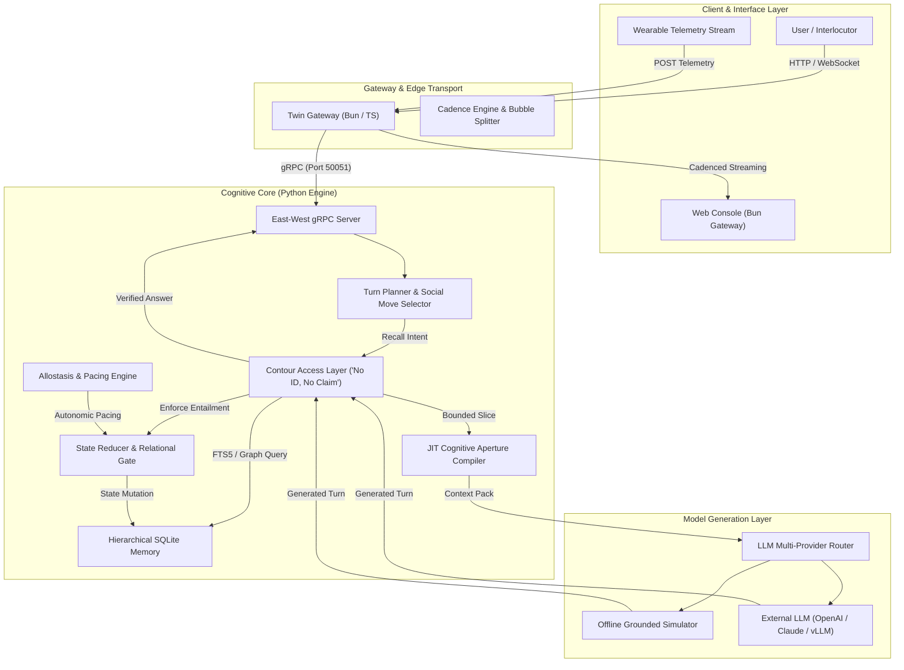

<p align="center">
  <h1 align="center">OmniTwin</h1>
  <p align="center"><strong>Cognitive Continuity for AI Agents</strong></p>
  <p align="center">
    <em>An open-source cognitive engine for persistent identity, grounded memory, relational continuity, and behavior-aware AI agents.</em>
  </p>
</p>

<p align="center">
  <a href="https://github.com/imMamdouhaboammar/OmniTwin/actions"></a>
  <a href="https://github.com/imMamdouhaboammar/OmniTwin/blob/main/LICENSE"></a>
  <a href="https://github.com/imMamdouhaboammar/OmniTwin/releases"></a>
  <a href="https://python.org"></a>
  <a href="https://bun.sh"></a>
</p>

---

## Overview

Existing Large Language Model (LLM) agents suffer from three fundamental limitations:
1. **Catastrophic Persona Drift**: System prompts degrade over multi-month interactions, leading to personality shifts and assistant-mode relapse.
2. **Ungrounded Hallucination**: RAG pipelines retrieve semantic snippets but lack strict verification barriers, allowing models to fabricate autobiographical facts.
3. **Flat Interaction Cadence**: Agents respond in monolithic paragraphs without conversational appetite, pacing, or relational boundaries.

**OmniTwin** solves this by separating cognitive state, epistemic authority, and conversational delivery into a verified local-first architecture. It enforces the **Contour Access Layer** invariant: **"No ID, No Claim"**—an agent may not make factual or autobiographical assertions unless verified against an authorized delivery slice.

---

## Capability Status

| Capability | Status | Description |
| :--- | :--- | :--- |
| **Contour Access Layer** | `Implemented` | Deterministic verification, empty citation guard, and semantic entailment checks. |
| **Hierarchical Memory** | `Implemented` | Multi-tier SQLite storage (Tier 0 Archive, Tier 1 Graph, Tier 2 Spreading Activation, Tier 3 JIT Aperture). |
| **Multi-Tenancy Scoping** | `Implemented` | Strict `(tenant_id, persona_id)` isolation across all queries, indexes, and graph operations. |
| **Deterministic State Reducer** | `Implemented` | Exponential salience decay, allostatic pacing, and relational boundary gates. |
| **Cadence & Bubble Engine** | `Implemented` | Empirical message chunking and typing latency calculations in Python and TypeScript. |
| **East-West gRPC Transport** | `Implemented` | Low-latency gRPC service (`localhost:50051`) with bearer authentication and optional TLS. |
| **REST & WebSocket Gateway** | `Implemented` | Bun TypeScript gateway providing streaming chat bubbles and wearable telemetry webhooks. |
| **Allostasis Pacing Engine** | `Implemented` | Informational cognitive load tracking and RMSSD / Baevsky Stress Index calculation. |
| **Long-Term Sleep Consolidation** | `Planned` | Scheduled background graph clustering and dream-cycle memory reorganization (v0.2.0). |
| **Distributed Multi-Node Sync** | `Planned` | CRDT-based edge-to-cloud multi-device synchronization (v0.3.0). |

---

## Architecture



---

## Quickstart

### Prerequisites
- Python 3.9+ (`pip` or `uv`)
- Bun 1.0+ (for the Twin Gateway service)

### 1. Installation

```bash
# Clone the repository
git clone https://github.com/imMamdouhaboammar/OmniTwin.git
cd OmniTwin

# Install Python package in editable mode
pip install -e .

# Or install dependencies via uv
uv pip install -e .
```

### 2. Run a Grounded Turn in Under 20 Lines

```python
from omnitwin import ContourEngine, StateReducer, TurnPlanner, CognitiveGenerator

# 1. Initialize local SQLite cognitive database
contour = ContourEngine("twin.db")
contour.init_schema()

# 2. Authorize an extract point
contour.insert_meta("meta_01", "synthetic", "Agent Notes", persona_id="alex")
contour.insert_ep(
    ep_id="ep_alex_01",
    meta_id="meta_01",
    grp="architecture",
    vector="databases",
    kind="belief",
    text="Prefers local-first SQLite architectures with deterministic state machines.",
    persona_id="alex",
)

# 3. Formulate grounded cognitive turn
reducer = StateReducer("twin.db")
planner = TurnPlanner(contour, reducer)
generator = CognitiveGenerator(contour=contour, reducer=reducer, planner=planner)

result = generator.execute_turn(
    persona_id="alex",
    user_id="collaborator",
    user_message="What database architecture do you recommend for local agents?",
)

print(result["answer"])
# Output: "From my perspective: Prefers local-first SQLite architectures with deterministic state machines.."
print(f"Verified: {result['verified']}, Citations: {result['cited_ids']}")
```

### 3. Launch the gRPC Server & Twin Gateway

```bash
# Terminal 1: Start East-West Cognitive Core (Port 50051)
omnitwin serve --host 127.0.0.1 --port 50051 --db twin.db

# Terminal 2: Start Twin Gateway & Web Console (Port 3030)
cd services/twin-gateway
bun install
bun run start
```

Visit `http://localhost:3030` to access the interactive **OmniTwin Console**.

---

## CLI Usage

OmniTwin includes a full-featured CLI utility (`omnitwin` or `bin/omnitwin`):

```bash
# Inspect version and license
omnitwin --version

# Initialize database and import synthetic persona
omnitwin init --persona examples/synthetic-persona/alex_cognitive_companion.json --persona-id alex

# Execute a one-shot grounded query
omnitwin query "What kind of coffee do you prefer?" --persona-id alex

# Inspect cognitive memories and dynamic state
omnitwin inspect --persona-id alex --user-id collaborator

# Export Mermaid knowledge graph
omnitwin graph --persona-id alex --format mermaid -o alex_graph.mmd
```

---

## Running Tests

OmniTwin ships with a zero-credential, local-first test suite covering unit, integration, and security invariant gates:

```bash
# Run Python pytest test suite (34 tests)
PYTHONPATH=src python3 -m pytest tests/

# Run Gateway test suite (8 tests via Bun)
cd services/twin-gateway && bun test
```

---

## Citation & Attribution

OmniTwin is licensed under the [Apache License, Version 2.0](LICENSE).

### Legal Redistribution Notice
When distributing or adapting OmniTwin or any of its derivative components:
1. You must retain the original copyright notice:
   ```
   Copyright 2026 Mamdouh Aboammar
   ```
2. You must retain the [NOTICE](NOTICE) file and include a copy of the [LICENSE](LICENSE).
3. If you modify any files, you must add prominent notices stating that you changed the files in accordance with Section 4(b) of Apache-2.0.

### Academic and Technical Citation
If you use OmniTwin in academic research, technical publications, or software benchmarks, please cite it using the following metadata:

```bibtex
@software{omnitwin2026,
  author = {Aboammar, Mamdouh},
  title = {OmniTwin: Cognitive Continuity for AI Agents},
  year = {2026},
  url = {https://github.com/imMamdouhaboammar/OmniTwin},
  version = {0.1.0},
  license = {Apache-2.0}
}
```

See [docs/licensing.md](docs/licensing.md) and [CITATION.cff](CITATION.cff) for complete details.

---

## Security & Privacy Policy

- **Fail-Closed Security**: By default, the gRPC service binds strictly to `127.0.0.1`. Binding to public interfaces without TLS is blocked.
- **Strict Data Minimization**: OmniTwin operates entirely on local SQLite storage. No telemetry or personal archives are transmitted to third parties.
- **Cascading Deletion**: Deleting a persona purges all episodic memories, associative edges, FTS indexes, and relationship records in a single transactional cascade.
- **Non-Clinical Informational Use**: Biometric processing (RMSSD, Baevsky Stress Index) is intended strictly for conversational pacing and cognitive appetite modulation. It must never be used for clinical diagnostics or medical evaluations.

For vulnerability reporting, consult [SECURITY.md](SECURITY.md).
For data protection details, consult [docs/privacy.md](docs/privacy.md).
