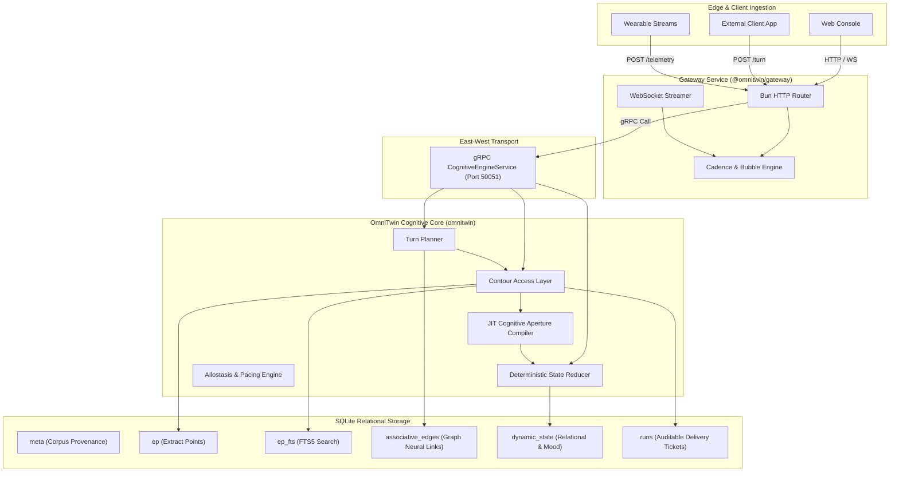
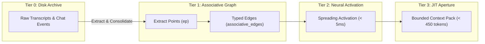

# OmniTwin Architecture & Technical Specification

OmniTwin is built upon a layered, local-first architecture that decouples **epistemic authority**, **dynamic state evolution**, and **conversational delivery**.

---

## High-Level Topology

---

## 1. Contour Access Layer ("No ID, No Claim")

The **Contour Access Layer** is the primary epistemic boundary of OmniTwin. Its fundamental invariant is:
> **An agent is never permitted to make an autobiographical or factual claim unless that claim is explicitly substantiated by an authorized Extract Point (EP) delivered within that run's ticket.**

### Invariants Enforced:
1. **Decoupled Recall vs. Delivery**: FTS5 candidate recall can find dozens of potential nodes, but the Planner locks down a bounded delivery slice (maximum 3 EPs) to prevent prompt bloat.
2. **Immutable Delivery Ticket (`runs`)**: Every turn generates an auditable `run_id` recording exactly which node IDs were delivered to the model.
3. **"No ID, No Claim" Verification**: `verify_turn` inspects model output for cited node IDs (e.g. `[ep_xxx]`). If the model cites an ID not in the delivery ticket, verification fails immediately.
4. **Empty Citation Guard**: If the model asserts personal autobiographical claims without citing authorized nodes, the claim is rejected.
5. **Semantic Entailment Verification**: The contour engine verifies that content tokens in the cited node actually align with the generated statement, preventing spurious citations.

---

## 2. Hierarchical Cognitive Memory Engine

OmniTwin structures memory into four distinct operational tiers:

- **Tier 0 (Disk Archive)**: Scalable event store for raw life logs, transcripts, and chat archives. Indexed with FTS5.
- **Tier 1 (Associative Graph)**: Consolidated Extract Points categorized by `grp`, `vector`, `kind`, and `tier` with directed edges (`CONTRADICTS_SUPERSEDES`, `CAUSES`, `CORROBORATES`).
- **Tier 2 (Hebbian Spreading Activation)**: Rapid relevance propagation across associative edges, allowing related memories to surface within 5ms.
- **Tier 3 (JIT Cognitive Aperture)**: Compact XML prompt representation (< 450 tokens) delivering minimal sufficient context.

---

## 3. Deterministic State Reducer

The state reducer tracks relational and emotional states over time without LLM non-determinism:
- **Exponential Salience Decay**: Active conversational concerns decay over time according to:
  \[
  S(t) = S_0 \cdot \exp\left(-\frac{\lambda \cdot \Delta t}{1 + \omega \cdot \text{Arousal}}\right)
  \]
- **Relational Permission Boundary Gates**: Enforces strict gates on teasing, vulnerability, affection, and romantic assumptions based on earned trust and intimacy.
- **Proposal-and-Reduction Contract**: Upstream LLMs can propose state mutations, but the reducer validates confidence scores (\(\ge 0.60\)) and schema rules before persisting mutations.

---

## 4. Cadence & Allostasis Pacing Engine

Human conversation is paced by cognitive appetite and physical energy:
- **Bubble Splitting**: Long model responses are split into conversational bursts (1–3 bubbles) based on punctuation and word limits.
- **Typing Latency Emulation**: Dynamically computes realistic typing delays with jitter based on character count.
- **Wearable Telemetry Processing**: Ingests R-R interval streams to estimate RMSSD (Root Mean Square of Successive Differences) and Baevsky Stress Index for conversational pacing.
