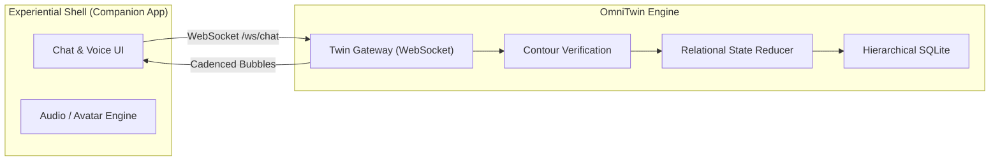

# Integrating Conversational Companion Frameworks with OmniTwin

Conversational companions (such as Rafiq or custom empathetic agents) require deep relational continuity, empathetic pacing, and consistent emotional boundaries. This guide explains how to connect companion architectures to OmniTwin.

---

## 1. Architectural Role of OmniTwin

In a companion architecture:
- **OmniTwin** serves as the persistent **Cognitive Core**: it stores the companion's core beliefs, memories with the user, relational trust levels, and autonomic energy state.
- **The Companion Framework** acts as the **Experiential Shell**: handling voice synthesis, mobile UI, avatar rendering, and user notifications.



---

## 2. Ingesting Companion Persona Packs

Companion personas often contain rich relational profiles:

```json
{
  "persona_id": "rafiq_companion",
  "name": "Rafiq",
  "tenant_id": "default",
  "traits": ["empathetic", "grounded", "protective"],
  "relationships": [
    {
      "user_id": "friend_01",
      "role": "close_friend",
      "closeness": 0.75,
      "trust": 0.85,
      "teasing_permission": 0.60,
      "romantic_assumption_allowed": false,
      "initial_mood": "calm",
      "initial_energy": 0.80
    }
  ]
}
```

Import this persona into OmniTwin:

```bash
omnitwin import companion_persona.json --persona-id rafiq_companion
```

---

## 3. Streaming Cadenced Bubbles via WebSocket

In companion applications, robotic walls of text break emotional immersion. Connect to OmniTwin's WebSocket streamer at `ws://localhost:3030/ws/chat`:

```javascript
const socket = new WebSocket("ws://localhost:3030/ws/chat");

socket.onopen = () => {
  socket.send(JSON.stringify({
    personaId: "rafiq_companion",
    userId: "friend_01",
    message: "Hey, do you remember our conversation yesterday?"
  }));
};

socket.onmessage = (event) => {
  const data = JSON.parse(event.data);
  if (data.type === "status" && data.status === "typing") {
    showTypingIndicator();
  } else if (data.type === "bubble") {
    renderChatBubble(data.text);
  } else if (data.type === "done") {
    hideTypingIndicator();
  }
};
```
Each bubble arrives with natural human-like typing delays and is pre-verified against "No ID, No Claim".
