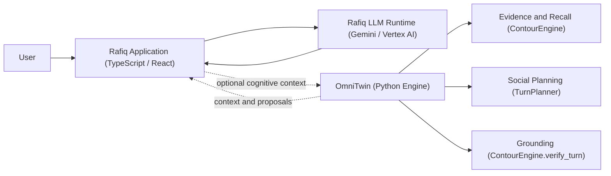

# Rafiq: Companion Application Integration

> **Status:** Architectural reference. A verified code-level integration between OmniTwin and Rafiq
> does not exist today. This document describes the natural interface boundary that the two projects
> share, provides a representative integration design, and identifies what a real integration would
> require. See [Current Integration Status](#current-integration-status) before building anything
> on this documentation.

---

## What is Rafiq?

[Rafiq (رفيق)](https://github.com/imMamdouhaboammar/Rafiq-Bot) is an open-source, local-first AI
companion application built with TypeScript and React. It provides:

- Configurable, persistent personas with behavioral state
- Browser-local persistence (Dexie / IndexedDB)
- Direct and group conversation interfaces
- WhatsApp-export persona analysis
- Gemini API / Vertex AI inference integration
- Optional Redis vector memory and semantic caching
- Web search, media workflows, and realtime tools
- Localizable conversation runtime (originally developed in Egyptian-Arabic dialect)

Rafiq is licensed under the **MIT License** and is independently maintained at
[github.com/imMamdouhaboammar/Rafiq-Bot](https://github.com/imMamdouhaboammar/Rafiq-Bot).

---

## Application Layer Responsibilities

The two projects operate at different architectural layers and are **complementary, not redundant**.

### Rafiq Owns

| Responsibility | Details |
|:---|:---|
| **Conversation UI** | React interface, message rendering, typing indicators, media display |
| **Persona settings and editing** | Persona creation, psychology profiles, behavioral presets |
| **Session & user management** | Browser-local chat sessions, user identity, settings storage |
| **Model inference orchestration** | Gemini API / Vertex AI routing, optional AgentRouter |
| **Application tools** | Web search, URL reading, image/media workflows |
| **Local memory** | Dexie/IndexedDB conversation history and persona state |
| **Continuity state** | Application-layer continuity, persona evolution over time |
| **Localization** | Locale, timezone, text direction, cultural adaptation |

### OmniTwin Contributes

OmniTwin provides reusable **cognitive primitives** that a companion application can call to augment
its intelligence. These are designed to work alongside—not replace—existing application logic.

| Cognitive Primitive | OmniTwin API |
|:---|:---|
| **Evidence-aware episodic recall** | `ContourEngine.search_episodes()` |
| **Bounded JIT context compilation** | `CognitivePromptCompiler.compile()` |
| **Conversational move planning** | `TurnPlanner.plan_turn()` |
| **Relational state gating** | `StateReducer.reduce()` |
| **Grounding verification** | `ContourEngine.verify_turn()` |
| **Allostatic pacing** | `AllostasisAdapter.pace_response()` |
| **Associative graph retrieval** | `CognitiveGraphEngine.traverse()` |
| **Biometric cognitive load signal** | `BiometricProcessor.process()` |

---

## Architecture: Application-Engine Separation



**Solid arrows** represent verified, production-active flows within each project today.
**Dashed arrows** represent the proposed integration boundary that does not yet have a
verified runtime implementation.

---

## Representative Turn Lifecycle

This is how an integrated turn would flow if OmniTwin were wired into Rafiq's inference path.
This lifecycle is **conceptual**—not a deployed integration today.

```
┌─────────────────────────────────────────────────────────────────────┐
│ 1. User sends message via Rafiq UI                                   │
│    → Rafiq application receives turn                                  │
│                                                                       │
│ 2. Rafiq optionally calls OmniTwin                                   │
│    → POST /turn or gRPC CognitiveTurn(persona_id, user_id, message)  │
│    → OmniTwin enforces tenant + persona scope                         │
│                                                                       │
│ 3. OmniTwin returns a bounded cognitive context pack                 │
│    → Relevant episodic evidence (≤ 450 tokens)                       │
│    → Planned conversational moves                                     │
│    → Allostatic pacing signal                                         │
│    → Relational boundary gates                                        │
│                                                                       │
│ 4. Rafiq injects cognitive context into its inference prompt          │
│    → Rafiq's own LLM generates the final reply                        │
│                                                                       │
│ 5. Rafiq optionally sends the generated turn back to OmniTwin        │
│    → ContourEngine.verify_turn() checks grounding                     │
│    → Verified state proposals persisted to OmniTwin's SQLite memory   │
│                                                                       │
│ 6. Rafiq renders the response to the user                             │
└─────────────────────────────────────────────────────────────────────┘
```

---

## Data Contracts

### Request: Cognitive Context Request (OmniTwin gRPC)

The existing `twin_engine.proto` defines the transport contract:

```protobuf
// See proto/twin_engine.proto
message CognitiveTurnRequest {
  string persona_id    = 1;  // Authorized persona identifier
  string user_id       = 2;  // Interlocutor / session identifier
  string message       = 3;  // Incoming user message
  string tenant_id     = 4;  // Isolation scope
  BiometricSample biometrics = 5; // Optional wearable signal
}
```

### Response: Cognitive Context Pack

```json
{
  "context_xml": "<context>...</context>",
  "cited_ids": ["ep_001", "ep_042"],
  "plan": { "primary_move": "reflect", "cadence_ms": 1200 },
  "allostatic_load": 0.24,
  "verified": true,
  "answer": "Optional pre-generated grounded turn"
}
```

Rafiq may use any or all of these fields. The `answer` field is optional—Rafiq's own LLM
can produce the final response using `context_xml` as additional grounding.

---

## What Should Not Be Duplicated

If OmniTwin is integrated into Rafiq, these responsibilities belong to exactly one system:

| Concern | Owner | Reason |
|:---|:---|:---|
| Episodic memory storage | **OmniTwin** | FTS5 + associative graph with tenant isolation |
| Conversation message history | **Rafiq** | Application persistence (Dexie/IndexedDB) |
| Persona settings | **Rafiq** | User-editable UI configuration |
| Cognitive state machine | **OmniTwin** | Deterministic `StateReducer` with relational gates |
| LLM routing / inference | **Rafiq** | Gemini API / Vertex AI integration |
| Grounding verification | **OmniTwin** | "No ID, No Claim" `ContourEngine` invariant |
| Session authorization | **Rafiq** | User sessions, auth tokens, browser identity |

---

## Privacy and Memory Isolation

OmniTwin's multi-tenancy model provides strong isolation guarantees:

- **Every query is scoped** to `(tenant_id, persona_id)`. Cross-persona memory leakage is
  structurally impossible within a correctly configured OmniTwin instance.
- **Cascading deletion**: Deleting a persona removes all episodic memories, associative edges,
  FTS5 indexes, and relationship records in a single transactional cascade.
- **No remote transmission**: OmniTwin operates entirely on local SQLite storage. No data is
  sent to third-party services unless explicitly configured through a custom LLM provider.

For a Rafiq integration, the application must:
1. Assign each Rafiq user a stable, unique `tenant_id` (never shared across users).
2. Pass the correct `persona_id` matching the active Rafiq persona.
3. Use bearer token authentication on the gRPC channel (see `OMNITWIN_AUTH_TOKEN` in `.env.example`).
4. Never pass raw WhatsApp exports or personally identifiable archives to OmniTwin—convert
   them to generalized episodic records first.

---

## Deployment Models

### Model A: Sidecar (Recommended for Development)

OmniTwin runs as a local sidecar process alongside Rafiq on the developer's machine:

```
Rafiq (localhost:3000) → gRPC → OmniTwin (localhost:50051)
```

Both processes share the same machine. No network exposure. Suitable for local development
and personal self-hosting.

### Model B: Containerized Microservice

OmniTwin runs as a Docker container with volume-mounted SQLite storage:

```yaml
# docker-compose.yml (illustrative, not provided in this release)
services:
  rafiq:
    image: rafiq-bot:latest
    environment:
      OMNITWIN_GRPC_URL: omnitwin:50051
  omnitwin:
    image: omnitwin:latest
    volumes:
      - ./data:/app/data
    command: ["omnitwin", "serve", "--host", "0.0.0.0", "--tls-cert", "/certs/server.crt"]
```

TLS is required when `--host` is not `127.0.0.1`. See [docs/security.md](../security.md).

### Model C: Edge-Decoupled (No Integration)

Rafiq runs with its own built-in memory. OmniTwin is not used. This is the current state
of both projects today and is a fully valid production configuration.

---

## Current Integration Status

| Item | Status |
|:---|:---|
| OmniTwin public Python API | ✅ Implemented & tested |
| OmniTwin gRPC transport | ✅ Implemented & tested |
| Rafiq application (TypeScript/React) | ✅ Independently operational |
| Code-level OmniTwin → Rafiq integration | ❌ Not yet implemented |
| Shared CI / integration test suite | ❌ Not yet created |
| Verified runtime interoperability | ❌ Not yet verified |

This document describes the **architectural design** of a potential integration.
No production deployment of this integration exists today.

---

## Opportunities for Community Contributions

If you would like to build the first real OmniTwin ↔ Rafiq integration, the recommended
starting points are:

1. **OmniTwin side** — Review and extend `src/omnitwin/server.py` to expose a clean
   REST endpoint alongside the existing gRPC interface (for easier JavaScript consumption).
   Open issues at [OmniTwin Issues](https://github.com/imMamdouhaboammar/OmniTwin/issues).

2. **Rafiq side** — Identify the inference orchestration layer where a cognitive context
   injection hook could be added without disrupting the existing model routing.
   Open issues at [Rafiq-Bot Issues](https://github.com/imMamdouhaboammar/Rafiq-Bot/issues).

3. **Cross-project** — Build the `examples/integrations/rafiq/` integration example in this
   repository and open a PR demonstrating the full request-response cycle with synthetic data.

4. **Protocol** — Define and publish a JSON schema for the cognitive context payload that
   both projects agree on, enabling language-agnostic adapters.

See [CONTRIBUTING.md](../../CONTRIBUTING.md) for OmniTwin contribution guidelines.

---

## Links

| Resource | URL |
|:---|:---|
| OmniTwin repository | https://github.com/imMamdouhaboammar/OmniTwin |
| Rafiq-Bot repository | https://github.com/imMamdouhaboammar/Rafiq-Bot |
| OmniTwin API Reference | [docs/api-reference.md](../api-reference.md) |
| OmniTwin Architecture | [docs/architecture.md](../architecture.md) |
| OmniTwin Security | [docs/security.md](../security.md) |
| OmniTwin Privacy | [docs/privacy.md](../privacy.md) |
| Rafiq License (MIT) | https://github.com/imMamdouhaboammar/Rafiq-Bot/blob/main/LICENSE |
| OmniTwin License (Apache-2.0) | https://github.com/imMamdouhaboammar/OmniTwin/blob/main/LICENSE |
